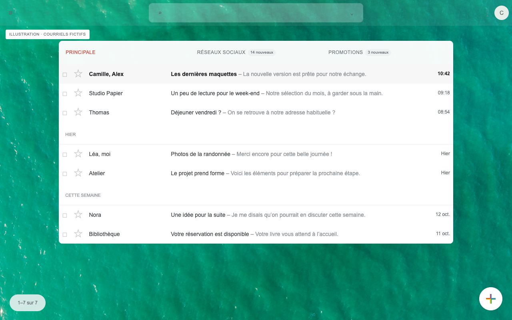
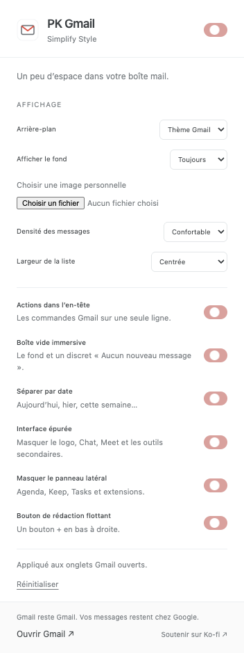
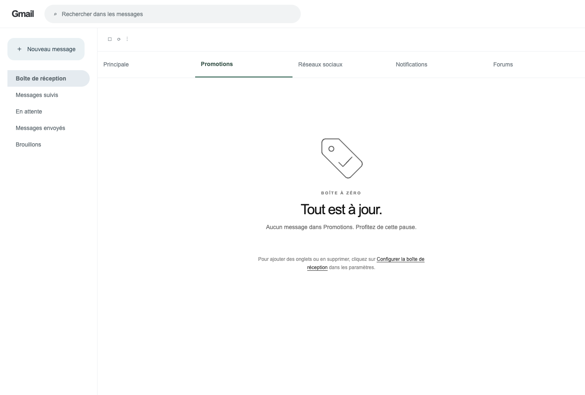

# PKMail


[🇫🇷 FR](README.md) · [🇬🇧 EN](README_en.md)

Client mail IMAP immersif — backend Python FastAPI + interface HTML/JS vanilla. Packagé en application native (macOS · Windows · Linux).

**Version 2026.10.85** — [Changelog](CHANGELOG.md)

[](store/index.html)
[](store/index.html)



[Réseaux sociaux](store/screenshots/13-studio-social.png) · [Forums](store/screenshots/14-studio-forums.png) — autres pictogrammes Studio sur données fictives.

## Fonctionnalités

### Interface V2 — Lab (6 concepts)
- **Six thèmes avec aperçu** : Focus OS (file une-ligne dense), Label Canvas (colonnes par libellé), Paper Reader (file papier), K7 Media Shelf (bibliothèque sombre en jaquettes), K7 Preview Deck (cartes sombres avec miniature HTML), K7 Preview Deck Clair (variante blanche et chaleureuse)
- **Catégories Gmail** : 6 catégories avec icône et couleur dédiée (Principale, Promotions, Réseaux, Notifications, Forums, Newsletters)
- **Layouts conservés** : catégories en haut ou rail latéral repliable, au choix dans les réglages
- **Fonds animés configurables** : désactivés, particules, ondes ou cassette, suspendus lorsque l'application est masquée
- **Navigation flèches** : `←` / `→` changent de catégorie, `↑` / `↓` (ou `J`/`K`) naviguent de mail en mail
- **Recherche Gmail** : `/` ouvre un overlay plein écran, recherche IMAP côté serveur (expéditeur, objet, contenu), navigation clavier des résultats
- **Vue conversation** : les messages d'un même fil s'empilent dans le lecteur — l'original replié en haut, le plus récent ouvert, chaque message se déplie à la demande
- **Nouveau message & transfert** : bouton flottant ＋ toujours visible, envoi réel via le backend, transfert pré-rempli avec le message cité
- **Annulation de suppression** : le mail disparaît immédiatement et un toast « Annuler » reste 6 secondes avant la suppression réelle
- **Thème OMP** : fond noir, hairlines discrètes et accent rose déclinable (rose, cyan, violet, ambre, vert, bleu), particules teintées à l'accent
- **Post-its** : mails envoyés à soi-même affichés en vrais post-its carrés sur un mur dédié ; activables et personnalisables avec une palette de huit couleurs ou une couleur libre
- **Newsletters** : carrousel multicartes (grille adaptative 4→8 colonnes), previews avec vraies images (hero + og:image), détail hero
- **Libellés et pièces jointes inline** : tags courts + icône trombone sur chaque ligne de liste
- **Compteur d'archives réel** : total `[Gmail]/Tous les messages` (fallback EXAMINE si STATUS renvoie 0)
- **Raccourcis Gmail** : `J`/`K` naviguer, `E` archiver, `#` supprimer, `Z` annuler, `C` nouveau message, `R` répondre, `F` transférer, `!` spam, `S` suivi, `L`/`V` libellés, `Shift+I`/`Shift+U` lu/non-lu, `U` retour liste, `[`/`]` archiver ± naviguer, `G` puis `I` boîte de réception — entièrement configurables et actifs dans tous les thèmes et lecteurs
- **Actualisation Gmail** : bouton toujours visible, mise à jour forcée au lancement, au retour dans l'app et toutes les 60 secondes
- **Comptes** : activation ou désactivation individuelle dans les réglages, navigables entièrement au clavier
- **Préchargement** : les autres catégories se chargent en tâche de fond
- **Pagination** : scroll infini + bouton « Charger plus » par catégorie
- **Regroupement par jour** : Aujourd'hui / Hier / date
- **Non-lus** : fond quasi blanc + gras
- **Écran de chargement immersif** plein écran avec barre animée légère
- **PWA + Chrome en local** : installable depuis `127.0.0.1:8000`, extension sans permission sensible ; Android en pause

### Extension Chrome — PK Simple Gmail
- **Chrome Web Store** : [PK Simple Gmail](https://chromewebstore.google.com/detail/pk-simple-gmail/kijhhekofbbmdgnheepmjcenehmgepgl) — version publique 2026.10.56, mise à jour 2026.10.73 soumise à examen.
- **PK Simple Gmail** : l'extension canonique, avec panneau latéral et six thèmes — *Natif*, *Studio* (35 tweaks cochables, dont « Boîte à zéro » : un pictogramme monochrome animé propre à chaque catégorie vide, « Annuler préservé », le renommage des onglets de catégories, « Mail / Google Agenda complet » avec bascule à triple logo (Mail, Agenda, Drive) dans l'en-tête et Agenda aux accents noirs), *Simplify* (fonds photo, boîte vide et volet de lecture), *Classique*, **Focus** (liste mono de 900 px, catégories en icônes, lignes de 35 px, sélection noire et raccourcis) et **Original** (rail de 64 px, recherche large, composer noir, liste aérée). Les autres concepts du Lab restent à transposer.
- **Mail / Agenda / Drive (Studio)** : la bascule à triple logo (Gmail + Agenda + Drive) remplace le logo dans la barre supérieure, sur les trois sites ; le segment actif est blanc. Elle ouvre le vrai Google Agenda et le vrai Drive dans le même onglet et la même fenêtre, avec création d'événements, vues et paramètres natifs, et le vrai Drive sur « Mon Drive » du compte actif ; Agenda et Drive reprennent les accents Studio (boutons noirs, jour courant noir, couleurs des calendriers, des événements et des fichiers conservées). Le bouton Mail ramène à la boîte de réception du compte actif (le logo Gmail, même actif, aussi). Chaque bascule charge la page Google correspondante. Activer « Modules · Mail / Google Agenda / Drive complet, même onglet » et autoriser `calendar.google.com` et `drive.google.com` lors de la mise à jour de l'extension.
- **Focus** : catégories affichables/masquables, alignement gauche/centre/droite et compteur total Gmail · [guide et activation](src/extension-pk/themes/focus-os/README.md) · [capture avec données fictives](store/screenshots/10-focus-os.png) · aperçu local dans `tools/previews/focus-os-preview/`.
- **Original** : [capture avec données fictives](store/screenshots/11-original.png) · aperçu local dans `tools/previews/simplemail-original-preview/`.
- Guide : [`src/extension-pk/`](src/extension-pk/). Simplify vit désormais comme thème (`src/extension-pk/themes/simplify/`) ; son extension autonome est archivée (`archives/versions/05-simplify-2026.10.16/`, hors git), distincte de PK Simple Gmail publiée sur le Chrome Web Store.

### Sombre Mail — client mail autonome (`tools/mail-client/`)
- **Interface mail indépendante** : serveur FastAPI local relié directement à vos boîtes IMAP/SMTP — multi-comptes, lecture, envoi réel, favoris, suppression, pièces jointes et temps réel (IMAP IDLE). Gmail n'est jamais ouvert, là où l'extension Chrome se contente de l'habiller.
- Mots de passe par variables d'environnement (`start.sh`), mode démo intégré (`MAIL_CLIENT_DEMO=1`) : aucune identification requise pour l'essayer. Documentation : [`tools/mail-client/`](tools/mail-client/README.md).

### Interface classique — V1
- Interface blanche immersive sans cartes, responsive du mobile aux grands écrans
- Page Paramètres plein écran (polices, thème, format date, newsletters, langues, comptes, à propos)
- Thème light/dark/fond photo
- Mode sélection avec actions groupées
- Recherche centrée avec compteur
- Favicon expéditeur avec fallback initiales
- Lecture immersive éditoriale par défaut, navigation `J` / `K` et HTML sandboxé
- Composeur plein écran
- Import/export des comptes (JSON : config + mots de passe + base SQLite + réglages localStorage)
- Flux RSS intégré
- Données de démo intégrées avec images réelles (Unsplash)
- Export/import sauvegarde **tout** : comptes, mots de passe, cache emails, réglages UI, largeurs colonnes, raccourcis

## Utilisation

### Mode développement
```bash
cd src/desktop
source var/secrets/mail.env  # ou export des variables
SIMPLEMAIL_AUTH=0 python3 main.py
# http://127.0.0.1:8000
```

### Mode application
```bash
src/desktop/start.sh                          # macOS (dev, lit var/secrets/mail.env)
# releases/macos/PKMail.app               # macOS (packagé)
# releases/windows/SimpleMail/SimpleMail.exe  # Windows
# releases/linux/SimpleMail/SimpleMail        # Linux
```

## Raccourcis clavier

| Touche | Action |
|--------|--------|
| `⌘,` / `Ctrl+,` | Ouvrir les Paramètres |
| `Escape` (1×) | Recul progressif (sélection → recherche → vue liste) |
| `Escape` (suppl.) | Ouvrir/fermer le menu latéral (drawer) |
| `G` puis `I` | Boîte de réception |
| `G` puis `S` | Messages suivis |
| `G` puis `T` | Corbeille |
| `G` puis `D` | Brouillons |
| `G` puis `A` | Archives |
| `G` puis `N` | Envoyés |
| `C` | Nouveau message |
| `J` / `↓` | Message suivant |
| `K` / `↑` | Message précédent |
| `Enter` / `Espace` | Ouvrir le message |
| `/` | Rechercher |

Tous les raccourcis sont configurables dans Paramètres → Raccourcis.

## Configuration

Les fichiers de configuration sont stockés par plateforme :
- **macOS** : `~/Library/Application Support/SimpleMail/`
- **Windows** : `%APPDATA%/SimpleMail/`
- **Linux** : `~/.local/share/SimpleMail/`

En développement, les mêmes fichiers vivent dans `src/desktop/var/` (hors git) :

Contenu :
- `config.json` : comptes IMAP/SMTP
- `secrets/mail.env` : mots de passe (jamais dans le dépôt)
- `simplemail.db` : cache des messages, réglages, labels

## Performances

Le backend maîtrise sa consommation mémoire :
- Interface sans boucle WebGL permanente ni filtre plein écran; les lignes hors écran utilisent `content-visibility`
- Navigation clavier des listes sans reconstruction complète du DOM à chaque déplacement
- Caches en RAM bornés (LRU) : threads (40 entrées), corps de messages (150 entrées, TTL 5 min)
- Instantané SQLite servi immédiatement, puis synchronisation Gmail silencieuse en arrière-plan
- Connexions IMAP réutilisées et chargement des dossiers limité aux statuts système utiles
- Fenêtre récente bornée pour les catégories et newsletters; les recherches générales restent plafonnées
- Thread de purge automatique des caches SQLite toutes les 10 min (`response_cache`, `msg_detail_cache`, `newsletter_msg_cache`)

## Installation

1. Cloner le projet
2. `cd src/desktop`
3. `mkdir -p var && cp config.example.json var/config.json`, renseigner vos comptes
4. Créer `var/secrets/mail.env` avec les mots de passe
5. Lancer `SIMPLEMAIL_AUTH=0 python3 main.py`

Pour tout transférer vers une autre machine : **Réglages → Comptes → Exporter**, puis **Importer** sur l'autre machine.

## Architecture locale

Le backend FastAPI, les identifiants Gmail et le cache restent sur l'ordinateur.
L'interface et la PWA utilisent :

```
http://127.0.0.1:8000/lab/
```

L'extension Chrome ouvre cette même adresse. Aucun backend SimpleMail n'est
actuellement publié. Android/iOS restent en pause jusqu'au choix d'un accès
privé (VPN/Tailscale) ou d'une architecture Gmail API + OAuth.

Le déploiement o2switch est désactivé et documenté uniquement pour référence dans
[`docs/DEPLOIEMENT_O2SWITCH.md`](docs/DEPLOIEMENT_O2SWITCH.md).

## Sécurité

### Authentification web (déploiement public)

Quand l'app est exposée sur Internet, l'authentification est **obligatoire** et
**activée par défaut** (`SIMPLEMAIL_AUTH=1`). Configurez un mot de passe :

```bash
# Variable d'environnement (cPanel → Setup Python App → Environment variables)
SIMPLEMAIL_PASSWORD=votre_mot_de_passe
```

Le mot de passe est vérifié via une session cookie (`sm_session`) :
- Cookie `httponly` + `secure` + `samesite=lax` (30 jours)
- Token généré via `secrets.token_urlsafe(32)` (256 bits)
- Rate limiting : 5 tentatives/minute par IP
- Nettoyage automatique des sessions expirées

### Protection des fichiers sensibles

| Fichier | Protégé par |
|---------|-------------|
| `config.json` (identifiants en `${VAR}`) | `.htaccess` + hors du document root |
| `secrets/mail.env` (mots de passe) | `.htaccess` + hors du document root |
| `*.db` (cache email) | `.htaccess` |
| Variables d'environnement | cPanel (pas dans le webroot) |

### Headers de sécurité
- `Content-Security-Policy` (CSP) : limite les sources autorisées
- `X-Content-Type-Options: nosniff`
- `X-Frame-Options: DENY`
- `Referrer-Policy: strict-origin-when-cross-origin`

### Recommandations
1. **Ne stockez jamais** les mots de passe directement dans `config.json` — utilisez les variables d'environnement (`${MAIL_PASSWORD}`)
2. **Activez l'authentification** sur tout déploiement public (`SIMPLEMAIL_AUTH=1`)
3. **Utilisez HTTPS** (Let's Encrypt dans cPanel)
4. **Surveillez** les logs cPanel pour détecter les tentatives suspectes
5. **Faites tourner** les mots de passe IMAP régulièrement, surtout après un déploiement

## Build

### macOS
```bash
cd src/desktop
./build_macos.sh
# → releases/macos/PKMail.app
# → /Applications/PKMail.app
```

### Windows
```powershell
cd src\desktop
.\build_windows.ps1
# → releases\windows\SimpleMail\
```

### Linux
```bash
cd src/desktop
sudo apt install libwebkit2gtk-4.0-dev  # système requis
./build_linux.sh
# → releases/linux/SimpleMail
```

### Prérequis build (toutes plateformes)
```bash
python3 -m pip install --user -r src/desktop/build-requirements.txt
```

Les bundles sont nettoyés : aucun compte, aucun mot de passe, aucune donnée personnelle embarquée.
La première ouverture crée automatiquement les dossiers de données utilisateur.

## Structure du projet

```
├── docs/                     ← Documentation (OAuth Gmail, déploiement o2switch, roadmap)
├── src/
│   ├── desktop/              ← Backend FastAPI de l'app classique + interface V2
│   │   ├── main.py           ← Backend FastAPI
│   │   ├── app.py            ← Lanceur pywebview (multi-plateforme)
│   │   ├── index.html        ← Interface complète
│   │   ├── var/              ← Données locales de dev (config, secrets, cache — hors git)
│   │   ├── config.example.json
│   │   └── build_macos.sh / build_linux.sh / build_windows.ps1
│   ├── extension-pk/         ← PK Simple Gmail — extension Chrome canonique (six thèmes)
│   │   └── sources/gmail.css ← Source CSS des tweaks (absorbée de l'ex-extension SimpleMail)
│   └── mobile/               ← Tentative mobile (Capacitor)
├── tools/
│   ├── lab/                  ← Tentatives Lab (atelier-actuel, focus-os)
│   ├── previews/             ← Aperçus fictifs des thèmes (focus-os, simplemail-original)
│   ├── mail-client/          ← Sombre Mail (client mail autonome)
│   ├── pkmail/               ← CLI Himalaya + interface Next.js + config locale
│   └── tester/               ← Page « Choisir une version » (port 9900)
├── releases/                 ← Builds macOS / Windows / Linux
├── archives/                 ← Anciennes versions, benchmark et Simplify (local, hors git)
├── store/                    ← Landing et kit média bilingue
└── README.md / CHANGELOG.md
```

## Historique

- **14 janvier 2022** — premier commit du dépôt ; l'extension est publiée le 15 janvier sur le Chrome Web Store.
- **2022–2024** — versions « PK Gmail / Simplify » : recherche centrée, fonds photo, boîte vide, densité et largeur de liste.
- **16 décembre 2024** — récupération des messages via API et refonte de la mise en forme côté client.
- **Mai 2026** — restructuration du dépôt et du README.
- **Août–septembre 2026** — PKMail (application native macOS, Windows, Linux), puis les thèmes du Lab : Focus OS, Label Canvas, Paper Reader, K7.
- **Octobre 2026** — PK Simple Gmail : six thèmes, Studio (tweaks, toasts, catégories renommables), bascule Mail / Agenda / Drive, accents Studio sur Agenda et Drive ; paquet 2026.10.73 soumis au Chrome Web Store.

## Soutien

Si PKMail vous est utile : [Ko-fi](https://ko-fi.com/pouark)
