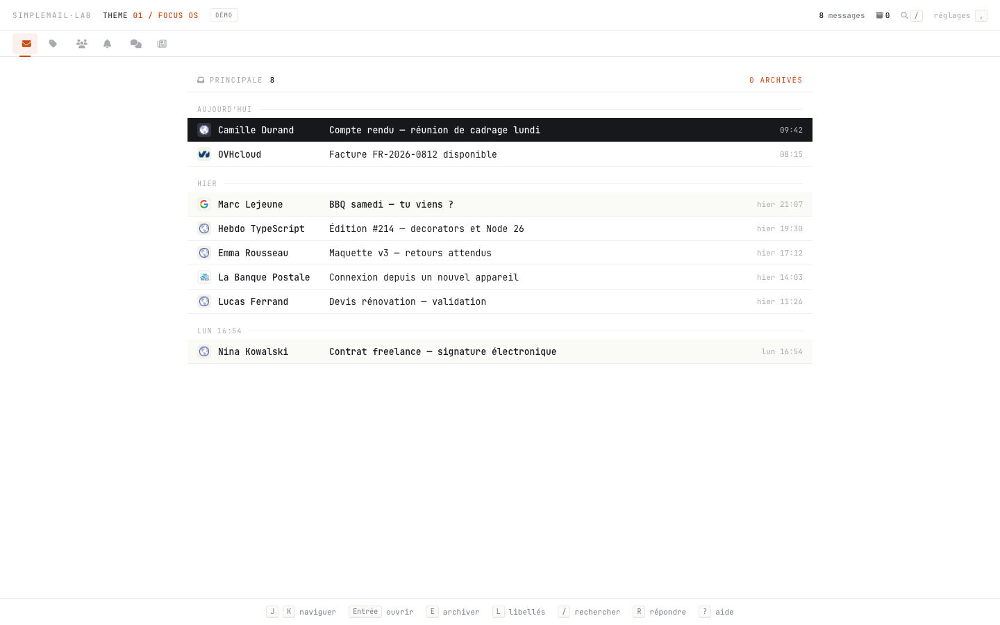
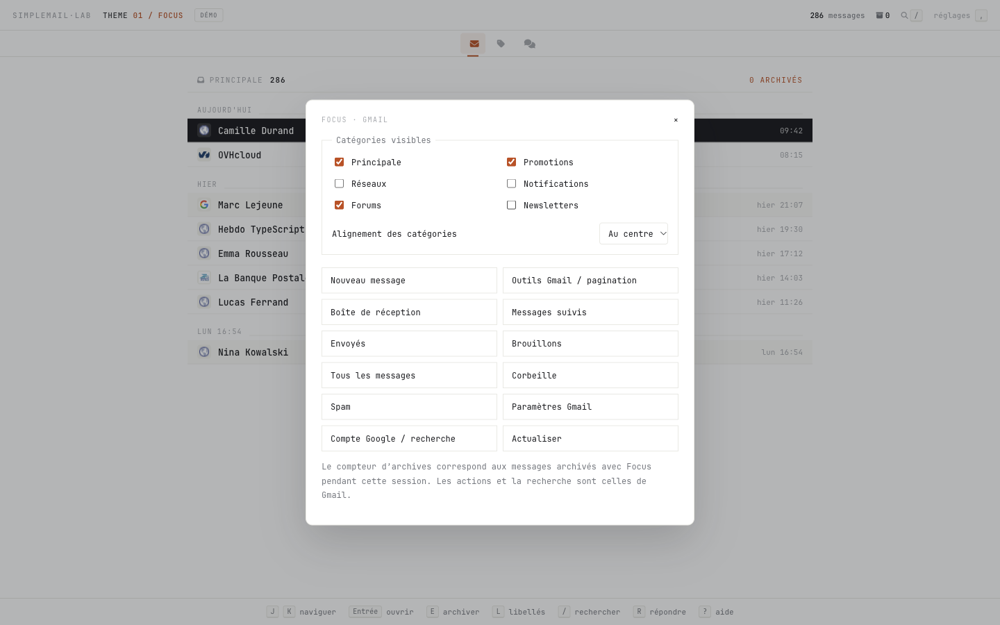

# Focus

Transposition du thème 01 de `archives/versions/03-lab-focus-os-2026.08.01/`
dans le DOM réel de Gmail. Sélectionner **Focus** dans le panneau PK Gmail
Studio après avoir rechargé l’extension depuis `chrome://extensions`.



Les deux fontes JetBrains Mono Nerd Font de l’archive sont embarquées. La liste
fait 900 px au maximum, avec des lignes de 35 px, un en-tête de 44 px, une barre
de catégories de 38 px et les couleurs de l’original. À 1440 × 900, la première
ligne commence en `(270, 170)` et le pied de page en `y=861`.

Les messages, pièces jointes, cases de sélection, actions et fenêtres de rédaction
restent gérés par Gmail. La vue de lecture conserve le HTML des messages ; elle
n’impose pas la typographie du thème aux newsletters. Les favicons utilisent le
même service Google que l’archive, avec une icône locale en cas d’échec.

## Personnaliser les catégories

Dans **réglages** (ou `,`) et dans le panneau PK Simple Gmail, choisir les catégories
à afficher puis leur alignement **à gauche**, **au centre** ou **à droite**.
Chaque catégorie peut être masquée, y compris Principale. Ces préférences sont
sauvegardées et synchronisées en direct entre les deux interfaces, sans recharger
Gmail. Elles modifient uniquement la barre de Focus, pas la configuration Gmail.
Masquer l'onglet actif laisse sa liste ouverte ; le menu réglages reste disponible,
même si tous les onglets sont masqués.



## Commandes

- `J` / `K`, `↓` / `↑` : naviguer ; `Entrée` : ouvrir.
- `E` : archiver ; `L` : ouvrir les libellés ; `R` : répondre ; `C` : rédiger.
- `/` : recherche Gmail ; `Échap` : fermer la recherche ou revenir à la liste.
- `,` ou **réglages** : catégories visibles, alignement, dossiers, pagination / outils Gmail, compte et paramètres.
- `?` : aide. Les raccourcis n’interceptent pas la saisie dans les messages.

Le compteur reprend le **total de la pagination Gmail**, au-delà des 100 lignes
chargées : « 1–100 sur 286 » affiche **286**, y compris sur les pages suivantes.
Il compte les conversations lorsque Gmail regroupe les messages. Les estimations
restent signalées par « ≈ » ; si Gmail ne fournit aucun total, le libellé précise
« messages chargés ». Les archives comptent les actions confirmées pendant la session
du thème. La catégorie Newsletters utilise la recherche
`in:inbox {category:updates list:unsubscribe}` ; elle n’est pas une catégorie
native supplémentaire de Gmail. Les catégories désactivées dans Gmail passent
également par sa recherche.

**Principale** revient toujours à l'onglet principal de la boîte de réception,
même après une recherche ou une visite de Promotions / Forums. Les filtres natifs
de recherche (Messagerie, Conversations, Espaces, De, date, etc.) occupent une
bande dédiée sous les catégories ; la liste se décale selon leur hauteur.
Les séparateurs de dates sont purement visuels, afin de préserver les tableaux
et les vues mises en cache par Gmail. L'identifiant `theme-focus-os` est conservé
pour garder la sélection enregistrée lors du renommage en **Focus**.

## Vérification locale

Depuis la racine du dépôt :

```sh
python3 -m http.server 8769 --bind 127.0.0.1
```

Ouvrir `http://127.0.0.1:8769/tools/previews/focus-os-preview/#inbox` pour l’aperçu fictif
(les huit messages de l’archive). Cette page charge les vrais fichiers du thème,
sur une structure DOM de test ; elle ne se connecte à aucune boîte mail.
`tools/previews/focus-os-preview/verify.mjs` exporte `verify(page)` pour une Page Ego.
`verify-categories.mjs` exporte `verifyCategories(page)` pour les allers-retours
de catégories, les onglets mis en cache et les filtres à 1440 et 390 px.
`verify-preferences.mjs` vérifie la persistance, les trois alignements, la synchronisation
avec le vrai panneau (stockage fictif) et les totaux natifs, estimés ou indisponibles.

Vérifications : mesures à 1440 × 900, stabilité de l’observateur, navigation,
recherche, lecture et retour, archivage fictif, recalcul des groupes de dates,
largeur 390 px. Vérification complémentaire sur Gmail dans une session Ego isolée :
liste, catégories, recherche et lecteur natifs. L’archivage réel et l’envoi ne sont
pas exécutés pendant les essais.
